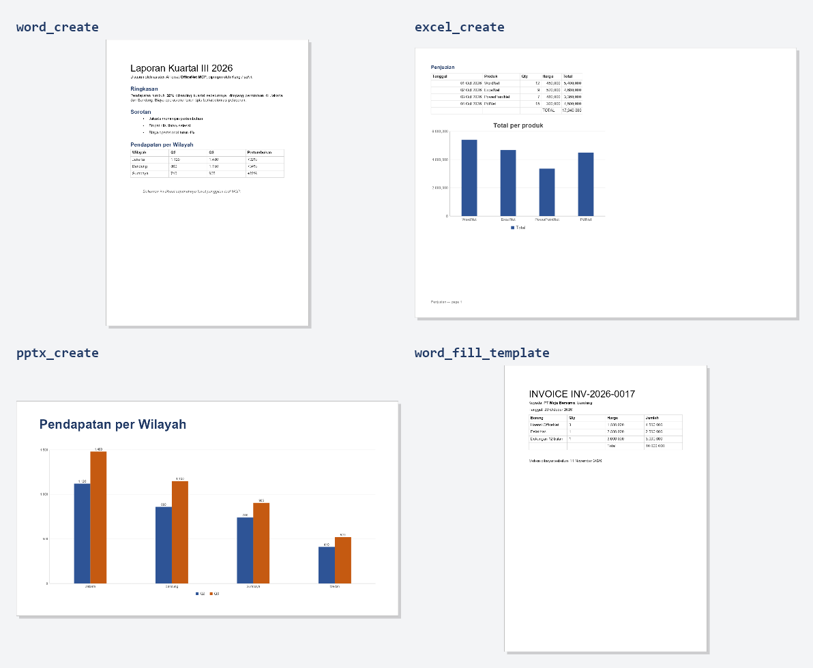
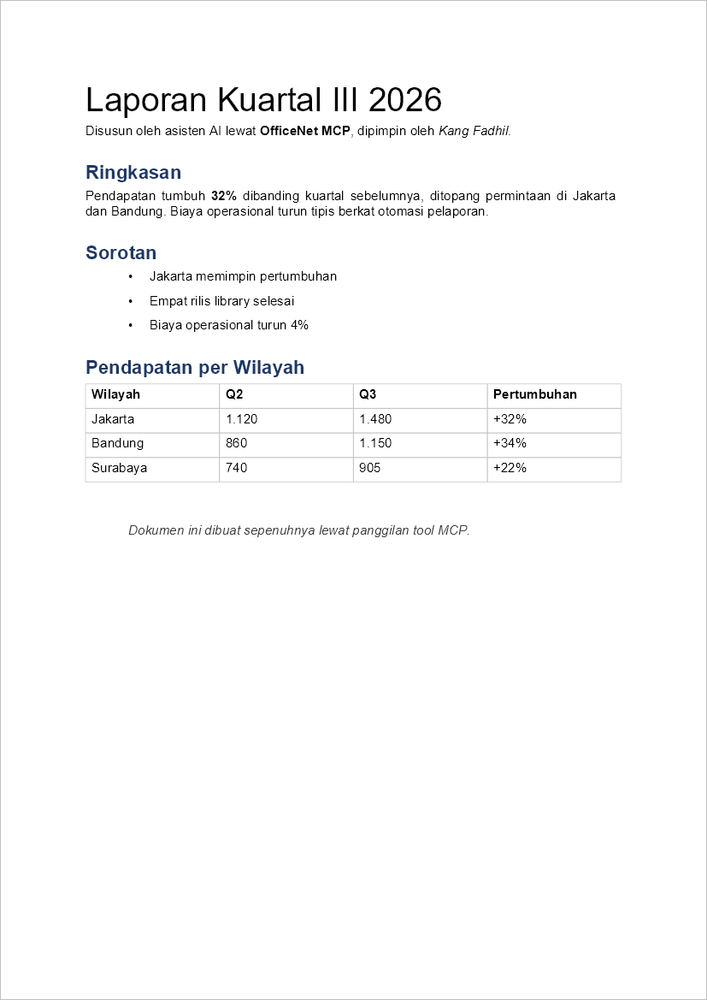
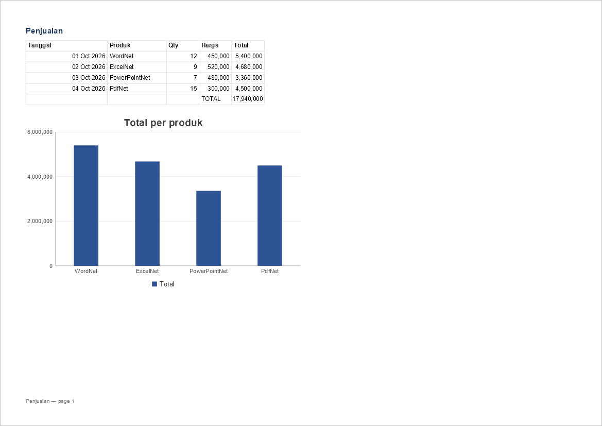
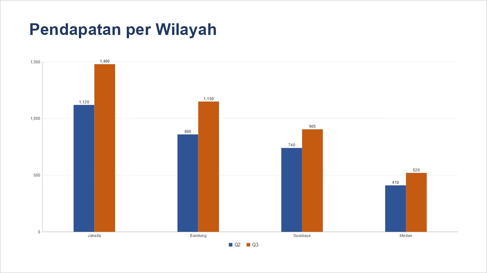

# OfficeNet MCP server

`officenet-mcp` lets an AI assistant — Claude, GitHub Copilot in VS Code, Cursor, or any client that
speaks the [Model Context Protocol](https://modelcontextprotocol.io) — create, edit, convert and
preview Word, Excel, PowerPoint and PDF files. It is OfficeNet behind 23 tools, running locally
over stdio, confined to one directory.

*Bahasa Indonesia: [id/Mcp.md](id/Mcp.md)*

Dibuat oleh Gravicode Studios, dipimpin oleh Kang Fadhil.

---

## What it made

Every image below is a document created **through the protocol**: `tools/ScreenshotGen` starts the
server as a separate process, calls its tools over stdio exactly as an assistant would, and renders
the files it wrote. None of it was drawn by hand or captured from Office.



| | |
|---|---|
| `word_create` — headings, `**bold**` from Markdown-style text, a list, a table |  |
| `excel_create` — formulas evaluated, number formats, a native chart |  |
| `pptx_create` — a chart slide, editable in PowerPoint |  |
| `word_fill_template` — invoice rows repeated from JSON, Rupiah formatting |  |

## Install

```bash
dotnet tool install -g Gravicode.OfficeNet.Mcp
officenet-mcp --help
```

Or from a clone, without installing:

```bash
dotnet run --project src/OfficeNet.Mcp -- --root ~/Documents/officenet
```

## Connect a client

**Claude Code**

```bash
claude mcp add officenet -- officenet-mcp --root ~/Documents/officenet
```

**Claude Desktop** — `claude_desktop_config.json`:

```json
{
  "mcpServers": {
    "officenet": {
      "command": "officenet-mcp",
      "args": ["--root", "C:\\Users\\you\\Documents\\officenet"]
    }
  }
}
```

**VS Code** — `.vscode/mcp.json`:

```json
{
  "servers": {
    "officenet": {
      "type": "stdio",
      "command": "officenet-mcp",
      "args": ["--root", "${workspaceFolder}/documents"]
    }
  }
}
```

Then ask in plain language — *"Buat laporan kuartal dalam Word dengan tabel pendapatan per wilayah,
lalu ekspor ke PDF dan tunjukkan halaman pertamanya."* The assistant picks the tools.

## Security model

An MCP server does what a model asks, and a model can be talked into asking for anything — by the
user, or by text hidden inside a document it was told to read. So the limits are enforced in code,
not left to the model's judgement:

- **One workspace.** Every path is resolved against `--root` and refused if it lands outside —
  `..`, an absolute path elsewhere, a sibling that merely shares the prefix (`C:\work` never admits
  `C:\workshop`), or a symbolic link inside the root that points out of it.
- **`--read-only`** refuses every tool that would create or change a file; reading, extracting and
  previewing still work. Use it when the assistant should only *look* at documents.
- **Errors are explained, not dumped.** A mistake the model can fix — an unknown block type, a sheet
  that does not exist, a conversion that is not supported — comes back as a readable error so the
  next call can correct it. Any other failure is reported generically, without a stack trace.
- **No network.** No tool fetches a URL; an HTML image with a remote `src` is skipped.
- **Hints for the client.** Tools carry `readOnlyHint` or `destructiveHint`, which clients use to
  decide what to confirm with the user first.

The root defaults to `$OFFICENET_MCP_ROOT`, then to the current directory. Point it at a folder
made for the purpose rather than your home directory.

## The tools

| Tool | What it does |
|---|---|
| **Word** | |
| `word_create` | A `.docx` from blocks: `heading`, `paragraph`, `quote`, `bullets`, `numbered`, `table`, `image`, `pagebreak`, `toc`. Text may use `**bold**` and `*italic*`. |
| `word_append` | Appends blocks to an existing document. |
| `word_fill_template` | Fills `{{field}}`, `{{a.b}}`, `{{total:N0}}`, repeating `{{#items}}…{{/items}}` and inverted `{{^x}}…{{/x}}` from JSON, in a chosen culture. |
| `word_replace_text` | Find and replace, including phrases Word split across runs. |
| `word_track_changes` | Lists tracked changes, or accepts or rejects all of them. |
| `word_protect` | Restricts editing (`readOnly`, `comments`, `trackedChanges`, `forms`, `none`). |
| `word_watermark` | Sets or removes a diagonal watermark. |
| `word_merge` / `word_split` | Joins documents; splits by section, heading or page break. |
| **Excel** | |
| `excel_create` | Sheets from rows; `=` strings are formulas, evaluated before saving; ISO dates become dates; per-column number formats; an optional chart. |
| `excel_write_cells` | Writes cells by address and recalculates. |
| `excel_read` | A sheet or range as rows of calculated values (capped at 200 rows). |
| `excel_add_chart` | A native chart from categories and series. |
| **PowerPoint** | |
| `pptx_create` | Slides of type `title`, `bullets`, `section`, `table`, `chart`, `image`, `blank`, with speaker notes. |
| `pptx_from_html` | HTML to a paginated deck. |
| **PDF** | |
| `pdf_merge` / `pdf_split` | Concatenate; split into parts of N pages. |
| `pdf_protect` | AES-256 encryption with a password. |
| **Any format** | |
| `convert` | `docx/xlsx/pptx → pdf`, `docx → html`, `html → docx/pptx`, `pdf → docx/xlsx`. |
| `extract_text` | Plain text, capped at 20 000 characters. |
| `document_info` | Format, metadata, and structure — headings, sheets, slides, pages. |
| `render_page` | One page as a PNG **image the model can see**, and optionally saved. |
| `list_files` | The documents in the workspace. |

`render_page` is what turns this from a file generator into something an assistant can check its
own work with: it creates a document, looks at it, and fixes what is wrong.

## Calling it from code

The server is an ordinary MCP server, so any MCP client library can drive it. With the official C#
SDK:

```csharp
using ModelContextProtocol.Client;

await using var client = await McpClient.CreateAsync(new StdioClientTransport(new()
{
    Name = "officenet",
    Command = "officenet-mcp",
    Arguments = ["--root", "documents"],
}));

var result = await client.CallToolAsync("word_create", new Dictionary<string, object?>
{
    ["path"] = "surat.docx",
    ["blocks"] = new object[]
    {
        new { type = "heading", text = "Surat Pemberitahuan" },
        new { type = "paragraph", text = "Dengan hormat, kami sampaikan **jadwal baru**." },
    },
});
```

## How it is tested

`tests/OfficeNet.Mcp.Tests` starts the server as a separate process and talks to it over stdio —
the same path every client takes. Calling the tool classes directly would miss the parts a client
actually meets: the JSON schemas generated from the parameter types, argument binding, how
exceptions become error results, and whether anything stray reaches stdout and corrupts the
stream. Each document type is created through the protocol and then opened again by the libraries
and checked by the independent OPC validator.

## See also

- [Unified API](OfficeNet.md) — `Office.Open`, `ConvertToPdf`, `ExtractText`, which several tools wrap
- [WordNet](WordNet.md), [ExcelNet](ExcelNet.md), [PowerPointNet](PowerPointNet.md), [PdfNet](PdfNet.md), [Rendering](Rendering.md)
